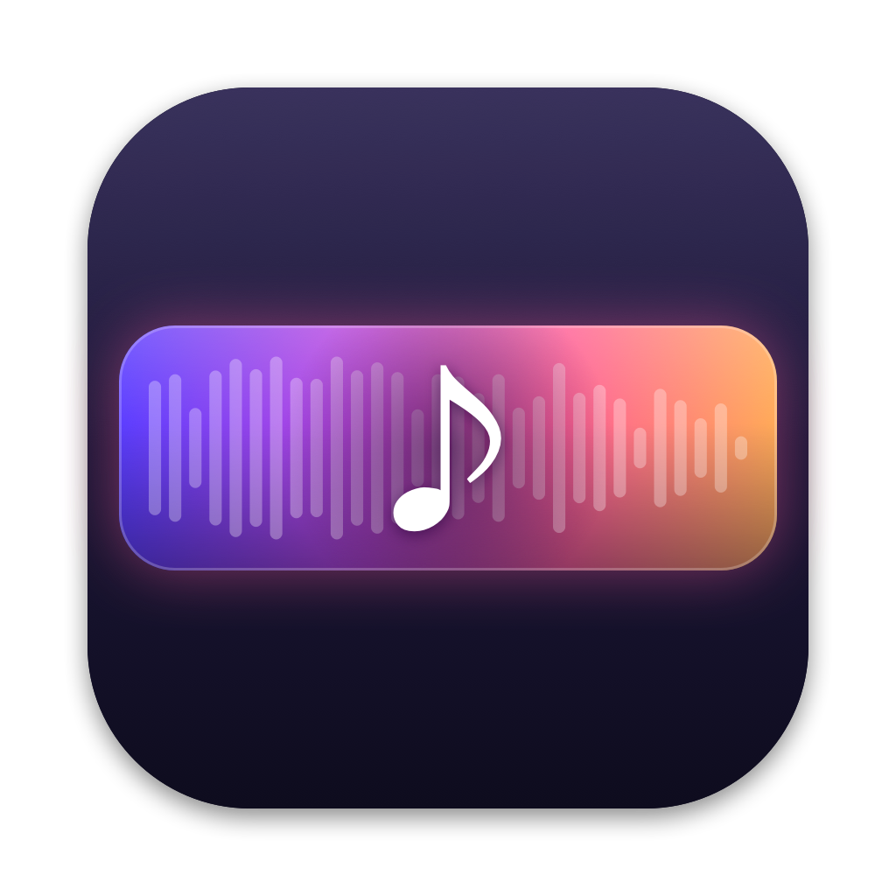

<p align="center"></p>

# LyricsBar

Synced lyrics, album art and media controls on the MacBook Pro Touch Bar, plus a built-in Subsonic / Navidrome player with a library window.

LyricsBar takes over the Touch Bar's control strip area with:

- **Live, line-synced lyrics** for whatever is playing (Spotify, Apple Music, browsers, LyricsBar's own player, any app that reports Now Playing to macOS). Lyrics come from [LRCLIB](https://lrclib.net).
- **Album art** and a background that takes its colour from the cover, with an optional audio visualizer.
- **Media controls**: a scrubber, skip, like, shuffle/repeat, and a swipeable, reorderable Up Next queue.
- **A playlist picker** for Subsonic, Spotify and Apple Music, with pinned playlists.
- **A built-in Subsonic/Navidrome player** with crossfade, an editable queue that survives restarts, Liked Songs (stars), and scrobbling.
- **Discord Rich Presence** with customizable text ("Listening to …", your own templates, an optional lyric line). It works with the Discord app and Vesktop.
- **A Library window** for Up Next, full lyrics, search, Liked Songs, albums, artists and playlists, with Settings in the same window.

## Requirements

- A Mac with a Touch Bar, running macOS 14.2 or later
- Xcode Command Line Tools (`xcode-select --install`), for `swiftc` and `/usr/bin/python3`
- [`media-control`](https://github.com/ungive/media-control) (`brew install media-control`), which reads the system Now Playing feed

## Install

```sh
git clone https://github.com/crispy-09/lyricsbar.git
cd lyricsbar
./install.sh
```

`install.sh` does three things:

- builds the app into `~/Applications/LyricsBar.app`
- copies the helper scripts to `~/.touchbar-lyrics/`
- installs two LaunchAgents: one for the app and one for the lyrics daemon (`lyricsd.py`). Both start at login and restart if they quit.

### Updating

```sh
git pull
./install.sh
```

Running `install.sh` again updates in place:
- It builds the new version first and only swaps it in if the build succeeds.
- It replaces the helper scripts and restarts both services.
- It keeps everything in `~/.touchbar-lyrics` (settings, saved queue, lyrics cache, scrobble queue) and your logins in the Keychain.
- If you signed with `LYRICSBAR_SIGN_ID`, it reuses the same certificate.
- It prints the old and new version.

macOS will ask for **System Audio Recording** permission the first time the visualizer runs on another app's audio. It also asks for **Automation** permission the first time LyricsBar controls Spotify or Music.

### Signing (optional)

`build.sh` ad-hoc signs by default. Credentials are kept in the Keychain, and an ad-hoc signature changes with every build. So macOS asks again after each rebuild, and can ask after restarts too. To make "Always Allow" stick across restarts, sign with a stable identity:

```sh
LYRICSBAR_SIGN_ID="<identity SHA-1 or name>" ./install.sh
```

A self-signed code-signing certificate is enough for restarts. Only an Apple-issued certificate (a free Apple ID "Personal Team" in Xcode works) also avoids the prompt after rebuilds.

## Using it

| On the Touch Bar | Does |
| --- | --- |
| Tap the lyrics | Play / pause (configurable) |
| Hold the lyrics | Show the media controls (configurable) |
| Swipe the lyrics left / right | Next / previous song |
| Tap the album art | Show / hide the media controls, or the playlist picker when nothing is playing |
| Hold the album art | Open / close Settings |
| Tap 📚 | Open / close the Library window |
| Optional buttons (Settings → Appearance → Buttons) | Keyboard brightness (tap for a slider, or slide across it), Siri, Screenshot (the ⇧⌘5 toolbar), and **regular Touch Bar**. They sit behind a ‹ button on the right; tap it to show them (they fold away again after a few seconds) |
| Regular Touch Bar button, or the menu bar icon's "Use the Regular Touch Bar" | Gives the Touch Bar back to macOS. A ♪ stays in the Control Strip: tap it (or use the menu bar icon) to bring LyricsBar back. It stays off across restarts until you do. The ♪ needs no setup, but only shows when the Touch Bar is set to show the Control Strip (System Settings → Keyboard → Touch Bar Settings) |
| Hold a playlist in the picker | Queue it next instead of playing it. For Spotify this works on playlists you made (up to 100 songs); Spotify doesn't let personal apps read playlists you only follow |
| In Up Next, hold and drag a song | Reorder it, or drop it on the trash to remove it |
| In Up Next, swipe right at the start of the list | Reveal **Clear**; tap it to empty Up Next |

Everything else is in **Settings** (Library window sidebar, or ⌘,):

- **General**: what ▶ starts when nothing is loaded, shuffle, resume, crossfade, lyric gestures, auto-hide timers
- **Appearance**: background (how long the album art stays after pausing), lyrics, what the bar shows while playing (lyrics, media controls, or title and artist) and while paused (lyrics, media controls, title and artist, rotating quotes, or your own phrase), visualizer, buttons. With a rotating wallpaper the background is black, because macOS doesn't report which picture is showing
- **Providers**: the providers shown in the picker, scrobbling, accounts
- **Discord**: Rich Presence

Playlists are managed in the Library's **Playlists** section. Pinned playlists are listed at the top; drag to reorder, or unpin. Use + for a new playlist, right-click a playlist to pin, rename, delete or edit its songs, or use **Edit** on a playlist's page.

### Providers

- **Subsonic / Navidrome**: sign in with your server URL, username and password. Only a salted token is stored, never the password.
- **Spotify**: create an app at developer.spotify.com with the redirect URI `http://127.0.0.1:8898/callback`, then paste its Client ID under Providers → Spotify. Playback happens in the Spotify app.
  - Up Next is editable on the Touch Bar and in the Library (needs Premium). See the quirks below.
  - Hold a playlist in the picker to queue it (up to 100 songs). This works for playlists you made, not ones you only follow.
  - If you connected Spotify before these features existed, reconnect it once to grant playback control.

#### Spotify queue quirks

Spotify's Web API can only read the queue and add to it. It has no way to remove, reorder or clear songs, and it can't change the queue without also changing the song that's playing. LyricsBar works around that, with some side effects:

- **How an edit works:** LyricsBar mutes Spotify, skips through the old queue to empty it, starts your edited list, then unmutes.
- **Edits wait for the song to end.** While a song plays, your edits show in Up Next straight away, but Spotify only gets them in the song's last second, so the song isn't interrupted. Expect a gap of a second or two before the next song. If you skip the song, the edits go through right away.
- **While paused, edits go through at once.** The song stays paused at the same spot.
- **"Play Now"** skips to the song with Spotify muted, so you don't hear the songs in between.
- **Clear** leaves just the current song. Spotify stops when it ends.
- **The original playlist doesn't continue.** After an edit, Spotify plays your edited list instead of the playlist or album you started, then its autoplay may continue with similar songs. Shuffle is turned off.
- **Skipped songs may show up in Spotify's recently played.** They're skipped within a second, so they don't count as plays.
- **Local files** in the queue can't be re-queued, so a queue containing them can't be edited.
- **Only the first ~20 songs can be kept.** Spotify only reports about 20 upcoming songs, so editing a longer queue (for example after queueing a big playlist) drops the songs past those.
- **Edits waiting for the song's end are dropped** if you start other music (another album, a playlist from the bar, or another app) before the song ends.
- **When Spotify plays on another device** (a phone or speaker), LyricsBar uses that device's volume and Spotify's "next" instead of the Mac's Spotify app, which is slower.
- **The queue Spotify reports can lag.** Up Next on the bar reloads when the song changes and every few seconds, but Spotify sometimes takes a moment to catch up.

- **Apple Music**: uses the Music app through AppleScript.

### Scrobbling

You can scrobble in either of two ways. Pick one per service; using both counts every song twice.

- Let **Navidrome** forward your plays: link Last.fm or ListenBrainz in Navidrome under your profile → Personal settings, and leave "Report plays to your Subsonic server" on.
- Or have **LyricsBar** send them directly. Connect Last.fm (with your own API key and secret) or ListenBrainz (with a user token) under Providers.

A play counts after half the song or 4 minutes, whichever comes first. Plays that can't be sent (offline, server down) are queued and retried every 5 minutes.

### Discord Rich Presence

Settings → **Discord**:

1. Create an application at [discord.com/developers/applications](https://discord.com/developers/applications). Its name is what people see, for example "Listening to **LyricsBar**".
2. Paste its **Application ID** and switch presence on.
3. Vesktop users: turn on Rich Presence (arRPC) in Vesktop's settings.

You can customize:
- the activity type ("Listening to" or "Playing") and the top line after it (default `{artist}`, so "Listening to Glass Animals"). Vesktop shows this; the official Discord app always shows your application's name there
- the two text lines and the picture's hover text, using templates with `{title}` `{artist}` `{album}` `{lyric}` `{player}`
- what the member list shows
- the progress bar
- whether it hides or shows "Paused" when paused
- which players count. Spotify is skipped by default because it already has its own presence.

Album art is optional. Subsonic cover links contain your login and are never sent, so the cover is looked up on Apple's public iTunes Search instead, which sends only the artist and album name.

## Privacy and security

- All credentials (the Subsonic token, Spotify tokens, Last.fm session and ListenBrainz token) are kept in a single item in your **login Keychain**. The Python helper receives them on stdin when it runs and never writes them to disk.
- Subsonic request URLs include an auth token, so LyricsBar's HTTP cache is **memory-only**.
- `~/.touchbar-lyrics/` holds settings, the saved queue, cached lyrics and the scrobble queue (song names only), and is readable only by you.
- The visualizer reads LyricsBar's own player directly. For other apps it taps only that app's audio, and only while music plays and the visualizer is on. Audio is analysed for levels and never stored.
- Network requests go only to your Subsonic server and `lrclib.net`, plus Spotify / Last.fm / ListenBrainz if you connect them and Apple's iTunes Search if you turn on Discord album art.
- Discord presence goes over the local Discord socket only, and only while it's switched on.

## Stable and Beta

You can keep a test build next to the normal one: `~/Applications/LyricsBar.app` is the stable version and `~/Applications/LyricsBar Beta.app` the beta. `~/.touchbar-lyrics/active.app` links to the one that runs:

```sh
./build.sh "$HOME/Applications/LyricsBar Beta.app"
~/.touchbar-lyrics/switch.sh beta     # or: stable
```

The menu bar icon also has a "Switch to Beta/Stable Version" item.

## Files

| Path | What |
| --- | --- |
| `Sources/` | The Swift app (AppKit Touch Bar UI, SwiftUI Library and Settings) |
| `scripts/lyricsd.py` | Lyrics daemon: follows Now Playing, fetches and caches LRC, writes `state.json` and `artwork.jpg` |
| `scripts/library.py` | Playlist helper for Subsonic, Spotify (including OAuth sign-in) and Apple Music |
| `launchd/` | LaunchAgent templates used by `install.sh` |

## Uninstall

```sh
launchctl bootout gui/$(id -u)/com.crispy.lyricsbar
launchctl bootout gui/$(id -u)/com.crispy.touchbar-lyrics
rm ~/Library/LaunchAgents/com.crispy.lyricsbar.plist ~/Library/LaunchAgents/com.crispy.touchbar-lyrics.plist
rm -rf ~/Applications/LyricsBar*.app ~/.touchbar-lyrics
security delete-generic-password -s com.crispy.lyricsbar -a credentials
```

## License

MIT. See [LICENSE](LICENSE).
